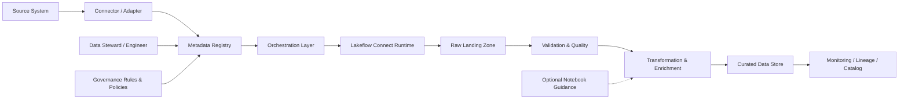

# Solution: Metadata-Driven Ingestion Framework — Lakeflow Connect

## Overview

This document outlines a metadata-driven ingestion framework for Lakeflow Connect. It captures a solution for onboarding, validating, and operating ingestion flows using metadata as the source of truth, reducing custom code for each source and improving governance, observability, and reuse.

> Based on the provided PDF: "Metadata-Driven Ingestion Framework: Lakeflow Connect"

## Objective

Enable fast, consistent, and governed ingestion of data from multiple sources by representing ingestion pipelines as metadata definitions interpreted by a runtime (Lakeflow Connect).

## Business Rationale

- Reduce time-to-onboard for new sources
- Eliminate repetitive custom pipeline code
- Maintain consistent quality, lineage, and governance
- Make ingestion patterns reusable across teams and domains

## Solution Summary

Use a central metadata registry that defines ingestion jobs. An orchestration layer reads metadata and triggers Lakeflow Connect to execute ingestion jobs. Validation, transformation, monitoring, and lineage capture are standardized as reusable components.

### Key benefits
- Declarative source onboarding
- Reusable templates for ingestion behaviors
- Embedded governance and lineage
- Scalable execution using Lakeflow Connect runtime

## Architecture (high level)



(Flow left-to-right: source → connector → metadata → orchestrator → runtime → landing → validate → transform → curated → monitoring.)

## Core Principles

1. Metadata as the single source of truth
2. Reusable ingestion patterns and templates
3. Separation of configuration, orchestration, and execution
4. Governance-by-default (owner, lineage, schema versioning)
5. Observability and error-first alerting

## Components and Responsibilities

- Metadata Registry
  - Stores ingestion definitions: connection, schedule, schema, transformations, quality rules, ownership
  - Versioned and validated on-registration

- Connector / Adapter
  - Implements source-specific extraction logic (API, DB, files, streaming)
  - Reusable connectors for common source types

- Orchestration Layer
  - Reads metadata and generates jobs
  - Manages scheduling, retries, and failure policies
  - Emits run metadata for observability

- Lakeflow Connect Runtime
  - Executes extraction and ingestion jobs (batch/streaming)
  - Manages parallelism, checkpoints, connectors lifecycle

- Validation & Quality
  - Schema checks, required fields, type validation, null thresholds, dedupe
  - Emits quality metrics and failure events

- Transformation & Enrichment
  - Declarative mapping transforms, UDF hooks for complex logic
  - Optional notebook guidance for complex workflows

- Monitoring & Lineage
  - Capture job status, latency, throughput, SLA metrics
  - Integrate with data catalog for lineage and provenance

## Metadata Model (suggested fields)

- id
- source_name
- source_type (db, api, file, stream)
- connection_profile (reference)
- owner
- schedule (cron / event-driven)
- mode (full, incremental)
- incremental_key / watermark
- schema (contract) + schema_version
- transformations (references to templates or code hooks)
- quality_rules (array/name of rule templates)
- retention / lifecycle
- governance flags (lineage_required, approved)

Example (JSON):

```json
{
  "id": "crm_customers_v1",
  "source_name": "crm_customers",
  "source_type": "api",
  "connection_profile": "conn_crm_prod",
  "owner": "customer-data-team",
  "schedule": "0 * * * *",
  "mode": "incremental",
  "incremental_key": "last_updated",
  "schema_version": "v1",
  "transformations": ["standardize_customer"],
  "quality_rules": ["no_null_id", "duplicate_check"],
  "governance": { "lineage_required": true }
}
```

## Typical Ingestion Lifecycle

1. Register source metadata in the registry (data steward or engineer)
2. Metadata validated (schema, governance checks)
3. Orchestrator schedules/creates a job based on metadata
4. Lakeflow Connect executes extraction
5. Data lands in raw staging
6. Validation & quality checks applied
7. Transformations and enrichment run
8. Curated dataset published and cataloged with lineage
9. Monitoring emits metrics and alerts on failures or drift

## Template Patterns

- Batch incremental with watermark
- Full refresh (historical loads)
- CDC / streaming ingestion
- File-based ingestion with schema evolution handling
- API pagination / rate-limited ingestion

Each pattern is a template with configurable parameters used by metadata entries.

## Error Handling and Retries

- Standardized retry/backoff policies defined in metadata
- Fail-fast for schema mismatch; quarantined landing area for suspect rows
- Alerting hooks (Slack/Email/Runbook link) for operational support

## Data Quality and Governance

- Quality rules executed at validation step, results recorded
- Thresholds trigger alerts or quarantines
- Schema versioning prevents silent schema drift
- Ownership and approval metadata required for production ingestion

## Observability

Emit and store:
- Job run events (start/finish/error)
- Row counts (read/accepted/rejected)
- Latency and throughput
- Quality rule metrics
- Lineage and provenance metadata

Integrate with your monitoring platform and data catalog.

## Security & Access

- Connection profiles stored securely (secrets manager)
- Least privilege access for runtimes to sources and storage
- Audit logs for metadata changes and job runs

## Implementation Roadmap (recommended)

1. Define metadata schema and registry (YAML/JSON schema)
2. Build metadata registration workflow and validation
3. Implement connectors for primary source types (DB, API, files)
4. Integrate Lakeflow Connect runtime for execution
5. Implement orchestration layer to interpret metadata and create runs
6. Build validation and quality modules
7. Implement lineage capture and monitoring hooks
8. Pilot with 3 representative data sources
9. Iterate, add templates, and onboard teams

## Success Criteria

- Mean time to onboard a new source reduced by X% (define target)
- Standard templates reused for >80% of ingestion jobs
- Schema drift detected within N hours
- Operational incidents due to ingestion reduced

## Risks & Mitigations

- Risk: Poor metadata quality
  - Mitigation: Metadata schema validation, linting, human review

- Risk: Edge-case connectors requiring custom code
  - Mitigation: Provide extension points and UDF hooks; keep templates for mainline

- Risk: Operational complexity in initial rollout
  - Mitigation: Start with small pilot and incrementally extend

## Appendix: Suggested Metadata Schema (YAML)

```yaml
id: string
source_name: string
source_type: enum(api, db, file, stream)
connection_profile: string
owner: string
schedule: cron
mode: enum(full, incremental)
incremental_key: string
schema_version: string
transformations:
  - name: string
quality_rules:
  - name: string
retention_days: int
governance:
  lineage_required: boolean
  approved: boolean
```

---

Created from the attached PDF and tailored for the lakeflow-connect-ingestion-poc project. If you want, I can:

- adjust this to a shorter executive summary
- add a concrete example for a specific source in your environment
- commit this to a different path or filename

